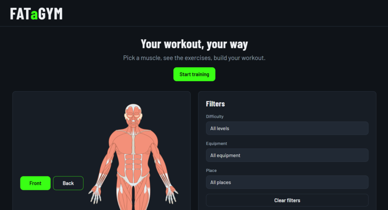
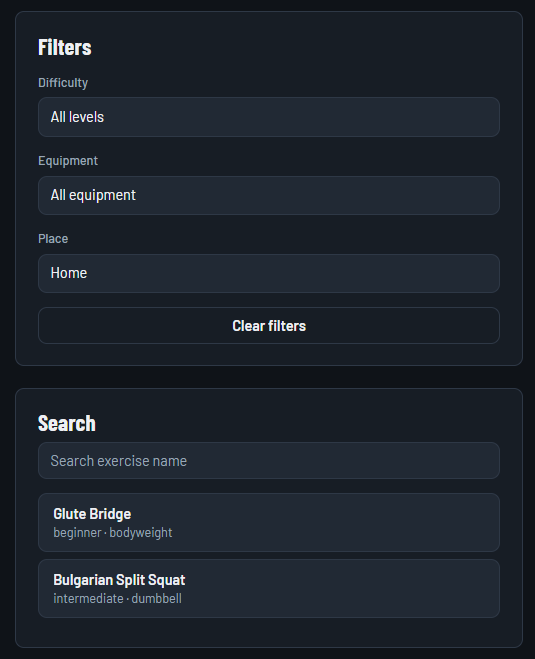
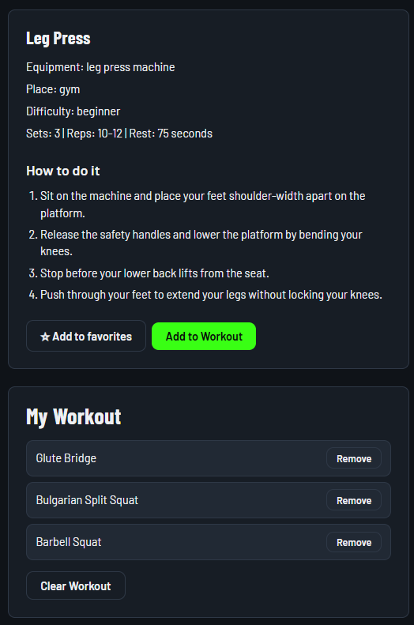
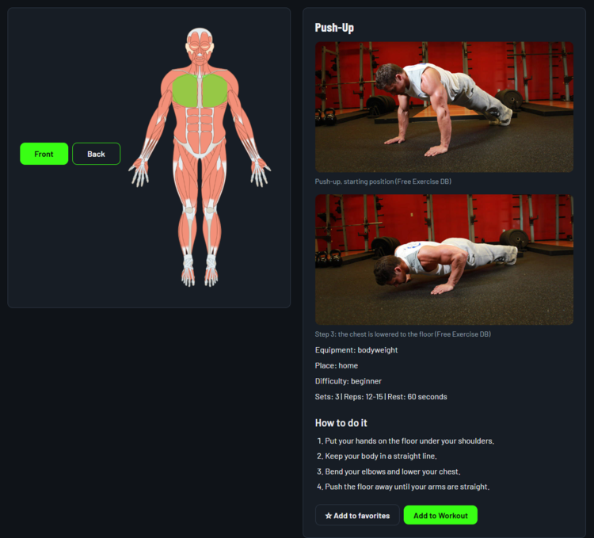
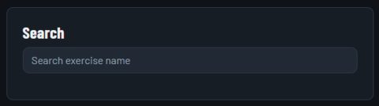
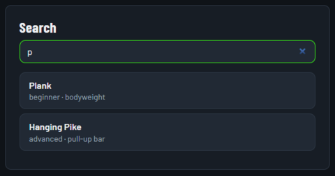
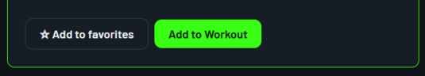
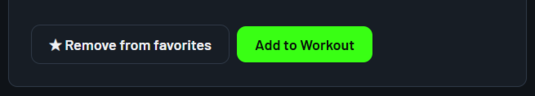

# FATaGYM User Manual

## Getting started and navigating the body map

1. Open the FATaGYM application. The main page displays the application introduction and the body map.
2. Select **Start Training** to jump to the main workout area.
3. The body map initially displays the front view of the human body.
4. Select **Front** or **Back** to switch between the front and back views.
5. Click a muscle group on the body map to display its available exercises.

## Filtering exercises

1. Select a muscle on the body map to display its exercises.
2. In the **Filters** panel, choose a difficulty level, equipment type, or place.
3. You can combine the filters. The exercise list updates to show matching exercises.
4. Choose **All levels**, **All equipment**, or **All places** to remove an individual filter.
5. Select **Clear filters** to reset every filter and display the full list again.

The available equipment options depend on the selected muscle group. If no exercises match, the list displays a message.

## Building and saving your workout

1. Select an exercise in the list to open its details.
2. Select **Add to Workout** to add it to **My Workout**. The same exercise cannot be added twice.
3. Select **Remove** beside an exercise to remove only that item.
4. Select **Clear Workout** to remove every exercise from the workout.
5. Your workout is saved automatically in this browser. It remains available after you refresh the page.

## Viewing exercises and exercise details

1. Select a muscle on the body map. The exercise list opens and shows the exercises of that muscle group.
2. Every row in the list shows the exercise name, the difficulty level and the equipment, so you can compare exercises without opening them.
3. Select an exercise to open the detail panel. The panel shows the photos of the exercise with their captions, the equipment, the place (home or gym), the difficulty, the number of sets, the repetitions, the rest time, and the numbered steps of the movement.
4. Select another exercise at any time; the detail panel is replaced by the new one.

### Searching for an exercise by name

1. Use the **Search** box above the exercise list.
2. The list is filtered while you type, so "press" leaves only the exercises whose name contains that word.
3. Clear the box to see the full list again.
4. The search works together with the filters, and it is cleared automatically when you select a new muscle group.

### Marking an exercise as a favorite

1. Open an exercise and select **Add to favorites** in the detail panel.
2. A star appears next to the exercise in the list, and the button changes to **Remove from favorites**.
3. Your favorites are stored in this browser, so they are still marked after you refresh the page.

### When a muscle group has no exercises

If the selected muscle group has no exercise data yet, the list shows the message **No exercises for this muscle yet.** If a search or a filter has no match, the list shows **No exercises match these filters.** The page keeps working, so you can select another muscle or clear the search box.

